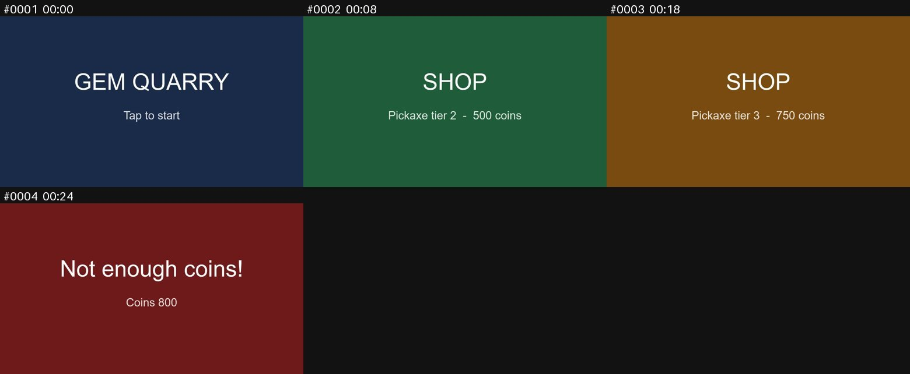

# video-narration-capture

Version 1.1.1. See the [changes](#changes) at the end.

## What It Does

A Claude Code skill that turns a narrated screen or gameplay recording into a pack of key frames and a timestamped transcript, then into a written breakdown that agents can work from. Claude can't watch video, so you record your screen and talk through it; the skill turns that into still frames plus text, and Claude writes it up:

- **Game teardown:** someone playing a game, as a reference for building one: core loop, systems, economy, UI, level design, feel. You play, not Claude, and nothing is ripped from the game, so there's no ban risk and the work stays on the inspiration side: behavior is described and reimplemented, not copied.
- **Software walkthrough:** an app, website or tool: step-by-step flows, a screen inventory, behavior and rules, and feel. Works for your own product (documentation, specs for tests) and for someone else's (a reference for building your own).
- **Bug report:** a recording made to show bugs, in a game or any other software: steps to reproduce, expected vs. actual, frame evidence around the moment it goes wrong, environment, where the bug likely lives (your content or the engine), a suspected cause, how to verify the fix, and what the video can't show (logs). Games get a section on session type, players and game state, with extra fields for UEFN (release, edit vs. launched session, devices, Verse).
- **Notes:** anything else (a talk, a review, a meeting): summary, sections with timestamps, key points, open questions.

Everything runs on your own machine. The narration is transcribed locally with [faster-whisper](https://github.com/SYSTRAN/faster-whisper), and nothing from your recordings is uploaded anywhere. The only downloads are the installs below and the speech model.

Here's the contact sheet from a pack made from a 32-second made-up recording of a fictional mining game:



And the start of its `timeline.md`, which pairs each frame with what was said while it was on screen:

```markdown
### #0002  00:08 to 00:18  `frames/0002_00m08s.jpg`
Now I'm on the shop screen The tier 2 pickaxe costs 500 coins Tier 3 costs 750

### #0003  00:18 to 00:24  `frames/0003_00m18s.jpg`
so prices seem to go up by half each tier

### #0004  00:24 to 00:32  `frames/0004_00m24s.jpg`
This should have let me buy it. I had 800 coins That looks like a bug
```

## Requirements

- Claude Code (the desktop app or the terminal CLI)
- Python 3.9 or newer
- About 1 GB of free disk space. **The install adds three things to your machine:**
  - ffmpeg, if it's missing (with winget on Windows or Homebrew on macOS)
  - two Python packages, `faster-whisper` and `pillow`, and the packages they need
  - the Whisper `small` speech model, about 500 MB, downloaded from Hugging Face during the install's self-test
- Internet access during the install. After that, it works offline.
- Tested on Windows 11 with ffmpeg 9.0.2, Python 3.14, faster-whisper 1.2.1 and Pillow 12.3. macOS: untested. Linux: untested, and ffmpeg has to be installed by hand first.

## Quick Start

From the root of the cloned repo (PowerShell, or bash with `python3` on macOS and Linux):

```bash
cd skills/video-narration-capture
python install.py
```

It ends with **Setup complete**. Then give Claude a recording, as in [Usage](#usage).

## Install with Claude Code

Say to Claude Code: *"Clone https://github.com/masfew/toolbox and install video-narration-capture."* With a clone already there, open Claude Code in it and say *"Install video-narration-capture."* Claude follows the repo's install rules: it does the steps under Claude does, and reads out the steps under You do one at a time, waiting for each.

**Claude does:**

1. Checks Python 3.9 or newer is installed, and asks before installing it if it's missing, with the command from [Install](#install) step 2.
2. Tells you what the installer adds to your machine (ffmpeg if it's missing, two Python packages, and a speech model of about 500 MB), and runs it once you agree.
3. Runs `python install.py` from `skills/video-narration-capture`, and checks it ends with **Setup complete**. This takes a few minutes, mostly the model download.
4. Checks Claude Code lists the `video-narration-capture` skill.

**You do:**

1. Linux only, before Claude runs the installer: install ffmpeg with your package manager, for example `sudo apt install ffmpeg`, since it asks for your password.
2. Approve the ffmpeg install if winget or Homebrew asks you to.
3. If Claude Code doesn't list the skill, restart Claude Code.

## Install

Everything below can be done by Claude Code on its own, apart from what [Install with Claude Code](#install-with-claude-code) lists under You do.

1. **Get the folder.** Either clone the repo (`git clone https://github.com/masfew/toolbox.git`), or download `video-narration-capture-v<version>.zip` from the [releases page](https://github.com/masfew/toolbox/releases) and unzip it.

2. **Python 3.9 or newer.** Check with `python --version` (on macOS and Linux, `python3 --version`; on Windows `py --version` also works). If it's missing:
   - Windows: `winget install Python.Python.3.13`, then open a new terminal so `python` is on PATH.
   - macOS: `brew install python` (install [Homebrew](https://brew.sh) first if needed).
   - Linux: your distro's package manager, for example `sudo apt install python3 python3-pip`.

3. **Linux only: install ffmpeg first**, for example `sudo apt install ffmpeg`. The installer only installs it on Windows and macOS.

4. **Run the installer from the `video-narration-capture` folder** (PowerShell, or bash with `python3` on macOS and Linux):

   ```bash
   python install.py
   ```

   It's safe to rerun, and it:
   - puts the tool at `~/.claude/tools/video-narration-capture`. In a git clone that's a link to this folder (a directory junction on Windows, which needs no admin rights; a symlink on macOS and Linux), so a `git pull` updates the skill. From an unzipped release it's a copy, and the unzipped folder can be deleted afterwards. `--copy` or `--link` overrides the choice.
   - installs the skill at `~/.claude/skills/video-narration-capture`, where Claude Code finds personal skills, as a link to the `skill` folder in `~/.claude/tools/video-narration-capture`;
   - installs ffmpeg if it's missing (winget on Windows, Homebrew on macOS);
   - installs the Python packages `faster-whisper` and `pillow` into the Python that runs the installer (for this user only if the system Python blocks global installs);
   - runs a self-test: builds a pack from a generated video and transcribes it, which downloads the Whisper `small` model (about 500 MB, a few minutes). `--no-test` skips this, and the model then downloads on the first recording instead.

   It ends with **Setup complete** and the Python it used, or with **FAILED:** and what to do. Fix that and rerun.

5. **Check Claude Code sees the skill.** New skills are usually picked up straight away. If `video-narration-capture` isn't in the skill list, restart Claude Code.

6. **Optional, per project:** create a `references/` folder at the project root (packs go in `references/<subject>/<session-name>/`). If the project has a `CLAUDE.md`, add a line saying recording packs live there and are made with the `video-narration-capture` skill.

## Configuration

There's no config file. Claude picks these options for `process_video.py` per recording, and you can ask for any of them ("process it with `--model medium`"):

| Option | What it does | Default | Example |
|---|---|---|---|
| `--out` | The pack folder | `<video name>_pack` next to the video | `--out references/shop/session-1` |
| `--scene` | Scene-change sensitivity from 0 to 1. Lower keeps more frames | `0.25` | `--scene 0.15` for app UIs |
| `--interval` | Keeps a frame at least this often, in seconds, even with no change | `10` | `--interval 5` |
| `--min-gap` | The fewest seconds between kept frames | `2` | `--min-gap 4` for fast gameplay |
| `--model` | Whisper model size. `medium` is better with names and jargon, `base` is faster | `small` | `--model medium` |
| `--language` | The narration's language code. Skips detection | detected | `--language en` |
| `--device` | `cuda` is much faster but needs an NVIDIA GPU with cuDNN | `cpu` | `--device cuda` |
| `--transcript-json` | Uses an existing transcript (a JSON list of `{start, end, text}` in seconds) instead of Whisper | none | `--transcript-json talk.json` |

Larger models download on first use: `medium` is about 1.5 GB.

## Usage

Record your screen with your microphone on, then tell Claude what it is and what you want from it:

> Process this recording: `C:\path\to\session.mp4`. It's <game name>, and I'm focusing on <the shop UI / the first ten minutes / the pet system>.

> Process `C:\path\to\elim-bug.mp4`. It's my UEFN island in a launched session with two players; the elimination counter skips when two players are eliminated at once. Write it up as a bug report.

> Process `C:\path\to\competitor-onboarding.mp4`. It's <product>'s onboarding flow, as a reference for ours.

Claude builds the pack, reads it from cheap to expensive (timeline, contact sheets, then selected full frames), pulls short ranges at a high frame rate where motion matters, and writes the breakdown from the matching template. It then tells you where the pack is, how many frames and how much narration it captured, and what the recording didn't cover.

A pack, conventionally at `references/<subject>/<session-name>/` in the project:

| File | What it is |
|---|---|
| `timeline.md` | Each key frame paired with the narration spoken while it was on screen |
| `transcript.md` / `.json` | The narration alone, timestamped (word timings in the JSON) |
| `frames/` | Full-size key frames, kept on scene changes plus one every 10 seconds |
| `sheets/` | Contact sheets: labelled grids of 9 thumbnails |
| `frames_dense/` | High-frame-rate ranges pulled later with the `dense` subcommand |
| `manifest.json` | All of the above as data |
| `teardown.md` / `walkthrough.md` / `bug-report.md` / `notes.md` | The written breakdown Claude produces |

### Recording Tips

- Check the microphone is being recorded. Many screen recorders capture system audio only by default. Turn game or system volume down so it doesn't drown your voice.
- Name things out loud ("this is the pet inventory", "now I'm on the billing settings page") and say numbers: prices, timers, limits.
- Say what you expected when something goes wrong ("this should have kept my discount").
- Say "watch this" before an animation, transition or glitch. Claude uses that as a cue to pull the moment at a higher frame rate.
- Pause for a second or two on important screens to get clean frames.

### Tuning

| Problem | Option |
|---|---|
| Too many frames | Raise `--scene` (default 0.25) or `--min-gap` (default 2) |
| Missed a screen, or small UI changes (toggles, toasts) | Lower `--scene` (try 0.15) or `--interval` (default 10) |
| Transcript garbles names and jargon | `--model medium` |
| NVIDIA GPU with cuDNN | `--device cuda` is much faster |

## How It Works

- `install.py` puts this folder at `~/.claude/tools/video-narration-capture` (a link or a copy), links `~/.claude/skills/video-narration-capture` to the `skill/` folder there, and installs the dependencies. It saves what it installed to `~/.claude/tools/video-narration-capture.install.json`, which a rerun and `--remove` read. It changes nothing else under `~/.claude`, and adds no hooks or settings. Since the skill link points at `~/.claude/tools`, not at the folder you installed from, only `~/.claude/tools/video-narration-capture` has to change if that folder moves.
- `skill/SKILL.md` tells Claude when to use the skill and how: which template to pick, how to build the pack, which order to read it in, and how to write the breakdown.
- `skill/scripts/process_video.py` builds the pack. Its `process` subcommand keeps frames with ffmpeg (on scene changes, plus one every `--interval` seconds), transcribes the audio with faster-whisper, pairs each word with the frame on screen when it was spoken, and writes contact sheets with Pillow. Its `dense` subcommand pulls a short range at a high frame rate.
- `skill/templates/` holds the breakdown structures: `game-teardown.md`, `software-walkthrough.md` and `bug-report.md`.
- Packs and breakdowns are written where Claude is told to put them (by default next to the video). The speech model is cached by Hugging Face, in `~/.cache/huggingface/hub` unless `HF_HOME` says otherwise.
- Audio is decoded with ffmpeg and passed to Whisper as samples, not as a file path. faster-whisper's own decoder uses PyAV, and faster-whisper 1.2.1 breaks with PyAV 17 and newer.

### Adding a Template

Add a Markdown file to `skill/templates/` in the same style as the others (what recording it's for, the output file name, then the structure in a fenced block), and add a row for it to the template table in `skill/SKILL.md`, step 2. In a copy install, rerun `python install.py` afterwards.

## Updating

Read the [changes](#changes) first for anything that needs you to do something. Each version is also on the repo's [releases page](https://github.com/masfew/toolbox/releases), tagged `video-narration-capture-v<version>`, with its notes and a zip of this folder.

From the root of the cloned repo, pull the new version, then rerun the install (PowerShell, or bash with `python3` on macOS and Linux):

```bash
git pull
cd skills/video-narration-capture
python install.py
```

The rerun is quick: ffmpeg, the packages and the model are already there. To stay on a version, check out its tag instead, then rerun the install (PowerShell or bash):

```bash
git fetch --tags
git checkout video-narration-capture-v1.0.0
cd skills/video-narration-capture
python install.py
```

Releases up to video-narration-capture-v1.1.1 have the tool's folder at the root of the repo, so after checking out one of those, it's `cd video-narration-capture` instead.

This moves the whole clone, so every other tool in it goes back to that point too. To return to the latest version, run `git checkout main` and `git pull`, then rerun the install. If you installed from a release zip instead, unzip the new release and run `python install.py` from its `video-narration-capture` folder: it replaces the earlier copy.

If this folder moves or is renamed (for example when the repo is reorganised), rerun `python install.py` from the new folder. It points `~/.claude/tools/video-narration-capture` there and leaves nothing behind from the old folder.

## Uninstall

From the `video-narration-capture` folder (PowerShell, or bash with `python3` on macOS and Linux):

```bash
python install.py --remove
```

If you installed from a release zip and deleted the unzipped folder, run the same command from `~/.claude/tools/video-narration-capture` instead.

This removes the skill from `~/.claude/skills`, and `~/.claude/tools/video-narration-capture` with its install record, even if you installed from a different folder. It leaves ffmpeg, the Python packages and the downloaded model in place, since other programs may use them, and prints how to remove each:

- Python packages: `python -m pip uninstall faster-whisper pillow`, with the same Python the installer used. pip leaves the packages they pulled in (such as `ctranslate2`, `onnxruntime`, `av` and `tokenizers`); uninstall those too if nothing else needs them.
- The model: delete the `models--Systran--faster-whisper-small` folder in `~/.cache/huggingface/hub` (and any other `models--Systran--faster-whisper-*` folder there, if you used `--model`).
- ffmpeg: `winget uninstall Gyan.FFmpeg` on Windows, or `brew uninstall ffmpeg` on macOS.

## Troubleshooting

| Problem | Cause | Fix |
|---|---|---|
| `ffmpeg not found` right after a winget install | winget only updates PATH for new terminals | The installer and the skill both look in winget's package folder too, so this is rare. Open a new terminal |
| **FAILED: winget could not install ffmpeg** or **brew could not install ffmpeg** | The package manager is blocked or offline | Install ffmpeg yourself (the message lists how), then rerun |
| **FAILED: pip install failed** | No internet, a proxy, a Python too new for the packages' builds, or a Python that blocks installs | Check the connection and rerun. The message says if an older Python (such as 3.12) would help. If installs are blocked, make a virtual environment (`python -m venv`), activate it and rerun the installer with its Python |
| **FAILED: the Whisper model download failed** | The model comes from huggingface.co, which wasn't reachable | Rerun once online. `python install.py --no-test` finishes setup without it, and the model downloads on the first recording |
| `faster-whisper is not installed` when the skill runs | Claude is running a different Python than the installer used | The installer prints its Python at the end. Use that one, or rerun the installer with the Python Claude uses |
| `... exists but is not this skill` | Something else is already at `~/.claude/skills/video-narration-capture` | Move it elsewhere, then rerun |
| `... exists but isn't this tool` | Something else is already at `~/.claude/tools/video-narration-capture` | Move it elsewhere, then rerun |
| `couldn't delete ~/.claude/tools/video-narration-capture` after `--remove` | A terminal or another program was open in that folder, so it was emptied but not deleted | Nothing else is left behind. Close it; the next `python install.py` or `--remove` deletes the empty folder |
| Hugging Face warns about symlinks on Windows | Windows didn't let it make symlinks in its cache | Harmless: the cache just uses a bit more disk. Turning on Windows Developer Mode silences it |
| No transcript in the pack | The recording has no audio track, or only system audio | Record with the microphone on. Many screen recorders capture system audio only by default |

## License

MIT. See the [LICENSE](https://github.com/masfew/toolbox/blob/main/LICENSE) file at the root of the repo.

## Changes

- 1.1.1: A `--remove` run from the installed copy, in a terminal open in that folder, could leave `~/.claude/tools/video-narration-capture` behind empty on Windows, and the next install then stopped with "exists but isn't this tool". Installs and `--remove` now delete that empty folder.
- 1.1.0: Installs now go through `~/.claude/tools/video-narration-capture`: the skill link points there, and only that one path points at the folder you installed from, so the install survives that folder moving (rerun `python install.py` from the new folder). The install keeps a record of what it added, which reruns and `--remove` use. A rerun is optional: a 1.0.0 install keeps working as it is, and rerunning switches it over.
- 1.0.0: First public version. Adds `install.py --remove`, and clearer installer messages when ffmpeg, pip or the model download fails.
